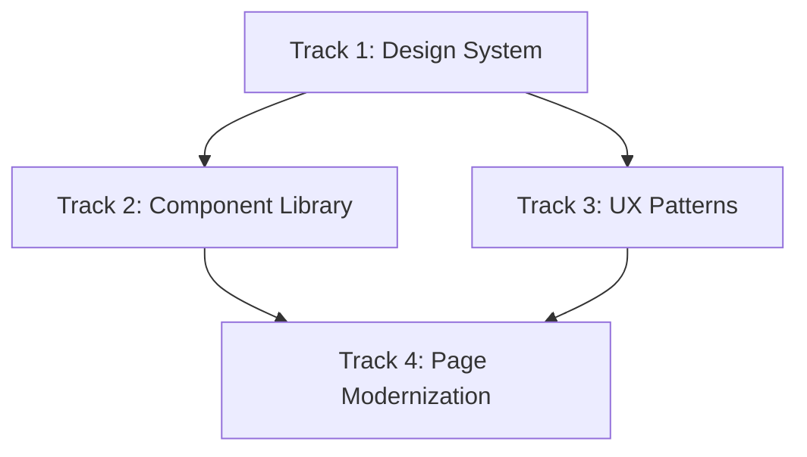
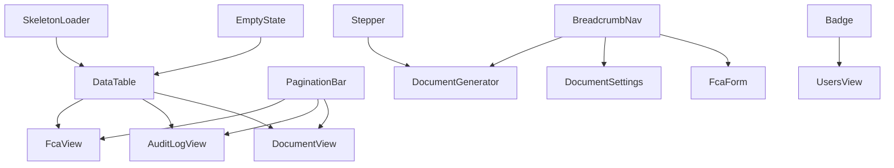
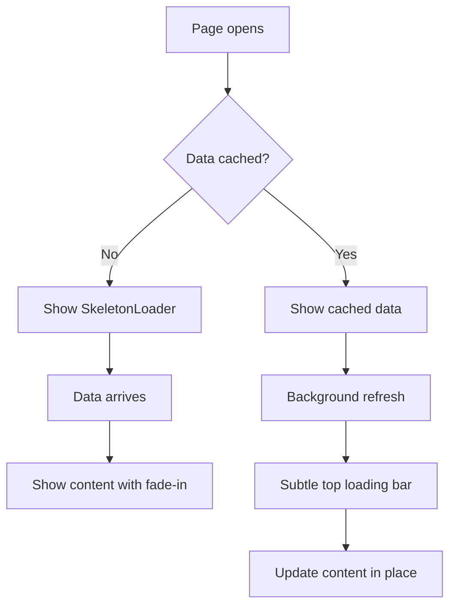
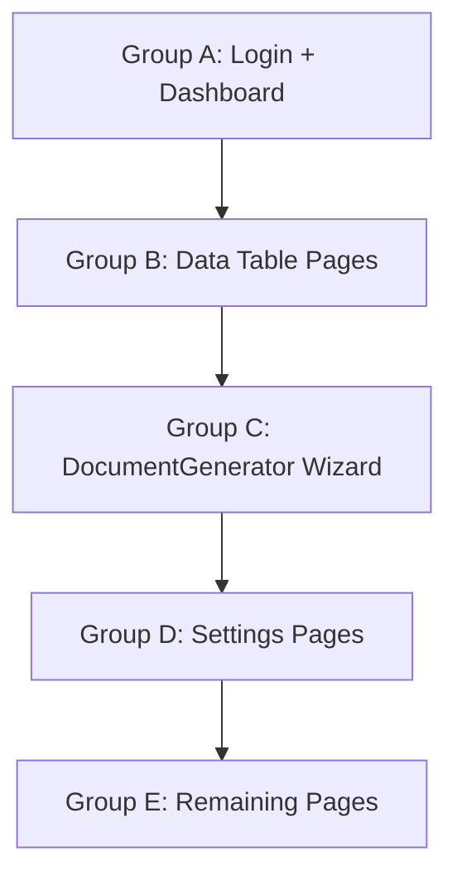

# UI Improvements Design Spec

**Date:** 2026-04-26
**Status:** Draft
**Supersedes:** `docs/superpowers/plans/2026-04-25-ui-modernization.md`

## Goal

Comprehensively improve the ABE Alcala MIS Vue 3 application UI across four areas: design system completeness, shared component library, UX interaction patterns, and page-level modernization. The result is a polished, consistent, accessible application with no inline modal duplication, proper loading/empty states, a wizard flow for document generation, and reusable components for all repeated patterns.

## Architecture

Organized as four layered tracks. Each track produces usable output and builds on the previous one. Tracks 2 and 3 can overlap after Track 1 is complete. Track 4 depends on both Tracks 2 and 3.



**Tech Stack:** Vue 3 single-file components, Vue Router, Pinia, Vite, Carbon icons, plain CSS variables, CSS media queries. No new dependencies.

**Existing foundation:** The app already has design tokens in `src/assets/base.css` (color scheme, brand colors, surface/text/border tokens, dark mode via `prefers-color-scheme`), utility classes in `src/assets/main.css` (`.app-page`, `.panel`, `.btn`, `.field-control`, `.table-wrap`, `.modal-overlay`, `.filters`, `.pagination`), and a responsive app shell in `src/App.vue` with collapsible sidebar and mobile drawer.

---

## Track 1: Design System

Fill gaps in the existing token system needed by Tracks 2-3.

### 1.1 Spacing Scale

Add to `:root` in `src/assets/base.css`:

```css
--space-1: 0.25rem; /* 4px */
--space-2: 0.5rem; /* 8px */
--space-3: 0.75rem; /* 12px */
--space-4: 1rem; /* 16px */
--space-5: 1.5rem; /* 24px */
--space-6: 2rem; /* 32px */
--space-8: 3rem; /* 48px */
```

### 1.2 Typography Scale

Add to `:root` in `src/assets/base.css`:

```css
--text-xs: 0.75rem;
--text-sm: 0.875rem;
--text-base: 1rem;
--text-lg: 1.125rem;
--text-xl: 1.25rem;
--text-2xl: 1.5rem;
```

### 1.3 Z-Index Scale

Add to `:root` in `src/assets/base.css`:

```css
--z-base: 1;
--z-dropdown: 100;
--z-sticky: 200;
--z-overlay: 300;
--z-modal: 400;
--z-toast: 500;
```

Update existing `z-index` references: `.modal-overlay` uses `var(--z-modal)`, `.toast-container` uses `var(--z-toast)`, sidebar drawer uses `var(--z-overlay)`.

### 1.4 Transition Tokens

Add to `:root` in `src/assets/base.css`:

```css
--duration-fast: 120ms;
--duration-normal: 180ms;
--duration-slow: 300ms;
--ease-out: cubic-bezier(0.16, 1, 0.3, 1);
--ease-in-out: cubic-bezier(0.45, 0, 0.55, 1);
```

### 1.5 Breakpoint Constants

Document as comments in `src/assets/base.css` (CSS custom properties cannot be used in media queries):

```css
/* Breakpoints: --bp-sm: 640px, --bp-md: 860px, --bp-lg: 1024px, --bp-xl: 1280px */
```

### 1.6 New Utility Classes

Add to `src/assets/main.css`:

- `.skeleton` — shimmer animation for loading placeholders (CSS `@keyframes` with `background-gradient` sweep)
- `.empty-state` — centered illustration + text + CTA layout
- `.stepper` — horizontal/vertical step indicator base
- `.breadcrumb` — navigation breadcrumb trail
- `.badge` — small pill-shaped status indicator with variant classes `.badge-success`, `.badge-warning`, `.badge-danger`, `.badge-neutral`, `.badge-info`
- `.sr-only` — screen-reader-only text for accessibility
- `.has-error` — error state for field controls (red border)
- `.field-error` — error message below a field (red text, small size)
- `.skip-link` — hidden skip-to-content link visible on focus
- `.loading-bar` — subtle animated bar at the top of a content area for background refresh indication (thin, brand-colored, animated width)

### Files Modified

- `src/assets/base.css` — add spacing, typography, z-index, transition tokens, breakpoint comments
- `src/assets/main.css` — add new utility classes, update z-index references in existing rules

---

## Track 2: Component Library

Create new shared components and improve existing ones.

### 2.1 SkeletonLoader.vue (New)

Shimmer placeholder for loading states. Replaces `DonutLoader` for page-level loading.

**Props:**

- `type` — `table` | `card` | `text` | `stat` (required)
- `rows` — number, for `type="table"` (default: 5)
- `lines` — number, for `type="text"` (default: 3)

**Behavior:**

- Uses `.skeleton` utility class with CSS shimmer animation
- `type="table"` renders a header row + N body rows with varying-width rectangles
- `type="card"` renders a rectangular card placeholder
- `type="text"` renders N lines of varying-width text placeholders
- `type="stat"` renders a small card with label + value placeholders

**File:** `src/components/SkeletonLoader.vue`

### 2.2 EmptyState.vue (New)

Centered message when no data exists.

**Props:**

- `icon` — Carbon icon component (optional)
- `title` — string (required)
- `description` — string (optional)

**Slots:**

- Default — optional CTA button

**Behavior:**

- Centered layout with muted colors
- Icon rendered at 2xl size with `var(--text-soft)` color
- Title in `var(--heading)`, description in `var(--text-muted)`
- CTA slot below description

**File:** `src/components/EmptyState.vue`

### 2.3 PaginationBar.vue (New)

Reusable pagination controls replacing duplicated markup across views.

**Props:**

- `currentPage` — number (required)
- `totalPages` — number (required)
- `perPage` — number (default: 10)
- `perPageOptions` — array of numbers (default: `[10, 20, 50]`)

**Events:**

- `page-change` — emitted with new page number
- `per-page-change` — emitted with new per-page value

**Behavior:**

- Prev/Next buttons with disabled state at boundaries
- "Page X of Y" display
- "Rows per page" select dropdown
- Uses global `.pagination` styles

**File:** `src/components/PaginationBar.vue`

### 2.4 BreadcrumbNav.vue (New)

Navigation breadcrumb trail for deep pages.

**Props:**

- `items` — array of `{ label: string, to?: string }` objects (required). Last item is current page (no link).

**Behavior:**

- Renders `RouterLink` for items with `to`, plain text for the last item
- Uses Carbon `ChevronRight20` as separator
- Responsive: truncates middle items on small screens with ellipsis
- Styled with `var(--text-muted)` for links, `var(--text)` for current page

**File:** `src/components/BreadcrumbNav.vue`

### 2.5 Badge.vue (New)

Small status indicator pill.

**Props:**

- `variant` — `success` | `warning` | `danger` | `neutral` | `info` (default: `neutral`)

**Slots:**

- Default — badge text

**Behavior:**

- Small pill shape with background tint and matching text color
- Uses semantic color tokens: success → `var(--success)`, danger → `var(--danger-strong)`, warning → `var(--warning)`, info → `var(--accent-blue)`, neutral → `var(--text-muted)`

**File:** `src/components/Badge.vue`

### 2.6 Stepper.vue (New)

Step indicator for multi-step flows.

**Props:**

- `steps` — array of strings (required), step labels
- `currentStep` — number (required), 0-based index

**Behavior:**

- Horizontal on desktop, vertical on mobile (below `--bp-md`)
- Completed steps show checkmark icon with `var(--brand-600)` color
- Current step is highlighted with `var(--brand-600)` background
- Future steps are muted with `var(--text-soft)` color
- Step circles connected by lines

**File:** `src/components/Stepper.vue`

### 2.7 Toast.vue (Improved)

Add enter/exit transitions and auto-dismiss.

**Changes:**

- Wrap toast list in `<TransitionGroup name="toast-slide">` instead of static `<div>`
- Add unique `id` to each toast for proper TransitionGroup keying (update `src/plugins/toast.js` to generate IDs)
- Add auto-dismiss after 5 seconds with a progress bar indicator
- Add `toast-slide-enter-active` / `toast-slide-leave-active` CSS transitions (slide-up enter, slide-down leave)
- Update z-index to use `var(--z-toast)`

**File:** `src/components/Toast.vue`, `src/plugins/toast.js`

### 2.8 DataTable.vue (Improved)

Integrate skeleton and empty state.

**New Props:**

- `loading` — boolean (default: false). When true, renders `<SkeletonLoader type="table">` instead of rows.
- `emptyIcon` — Carbon icon component (optional). Passed to `<EmptyState>`.
- `emptyTitle` — string (default: "No records found").
- `emptyDescription` — string (optional). Passed to `<EmptyState>`.

**Behavior:**

- When `loading` is true: hide table rows, show skeleton
- When `data` is empty and not loading: show `<EmptyState>` instead of plain text
- When `data` has items: show table as before
- Keep existing sort/column/slot behavior unchanged

**File:** `src/components/DataTable.vue`

### 2.9 Modal.vue (Improved)

Add size variants and persistent option.

**New Props:**

- `size` — `sm` | `md` | `lg` (default: `md`). Controls `.modal-content` max-width: 360px / 440px / 600px.
- `persistent` — boolean (default: false). When true, clicking overlay does not emit `close`.

**Behavior:**

- Size prop adds a class `modal-{size}` to `.modal-content`
- Persistent prop conditionally removes `@click.self` on overlay
- Keep existing transition and close button behavior

**File:** `src/components/Modal.vue`

### Component Dependency Graph



### Files Created

- `src/components/SkeletonLoader.vue`
- `src/components/EmptyState.vue`
- `src/components/PaginationBar.vue`
- `src/components/BreadcrumbNav.vue`
- `src/components/Badge.vue`
- `src/components/Stepper.vue`

### Files Modified

- `src/components/Toast.vue`
- `src/plugins/toast.js`
- `src/components/DataTable.vue`
- `src/components/Modal.vue`

---

## Track 3: UX Patterns

Define interaction patterns that span multiple components or views.

### 3.1 DocumentGenerator Wizard Flow

Convert the 590-line flat form in `DocumentGenerator.vue` into a 5-step wizard.

**Steps:**

| Step                   | Content                          | Validation                        |
| ---------------------- | -------------------------------- | --------------------------------- |
| 1. Select FCA          | FCA search dropdown              | Must select an FCA                |
| 2. Select Group        | Group search dropdown            | Must select a group               |
| 3. Choose Documents    | Document checkboxes with search  | Must select at least one document |
| 4. Fill Form           | Dynamic form fields per document | Required fields must be filled    |
| 5. Review and Generate | Summary of all selections        | Confirm to generate               |

**Design decisions:**

- Use `Stepper.vue` at the top of the page
- Each step is a `<section v-if="currentStep === N">` block
- Back/Next buttons at the bottom of each step
- Step validation on Next click: show inline errors if invalid, do not advance
- Step 5 shows read-only summary: selected FCA name, group name, document list, filled form values
- URL hash sync via `useHashModal` pattern: `#step-2` etc. so browser back button works
- Form data preserved when navigating back (already works with `reactive`/`ref` state)
- View mode (when `route.query.document_id` exists) skips the stepper and shows filled document directly
- Replace `DonutLoader` during generation with progress state on the Generate button

### 3.2 Form Validation Convention

**Convention:**

- Each form field component gets an optional `error` prop (string) and `required` prop (boolean)
- When `error` is truthy: field shows red border (`.has-error`) and error message below (`.field-error`)
- Error message uses `var(--danger-strong)` color and `var(--text-sm)` size
- Validation timing: on blur and on form submit (not on input — too aggressive)
- No validation library — a `validate()` function per form returns an errors object

**CSS additions** (in `src/assets/main.css` via Track 1):

```css
.field-control.has-error {
  border-color: var(--danger-strong);
}
.field-error {
  color: var(--danger-strong);
  font-size: var(--text-sm);
  margin-top: var(--space-1);
}
```

**Components to update (in Track 3, not deferred to Track 4):** `InputField.vue`, `DateField.vue`, `DateInputField.vue`, `DropdownField.vue`, `UserNameField.vue`, `PasswordField.vue`, `CheckboxField.vue`, `RadioField.vue`, `TableField.vue` — add `error` and `required` props, render `.field-error` when error is truthy. These prop additions happen in Track 3 so the components are ready for Track 4 page views to use them.

### 3.3 Destructive Action Confirmation

**Convention:**

- Use `Modal.vue` with `persistent` prop for destructive confirmations
- Standard pattern: modal title clearly states the action ("Delete FCA?"), body explains consequence, red "Delete" button, gray "Cancel" button
- Create `useConfirmDialog` composable to avoid duplicating modal state in every view

**Composable API:**

```js
const { confirm, isOpen, title, message, dangerLabel, onConfirm } = useConfirmDialog()

async function deleteFca(id) {
  const ok = await confirm('Delete FCA?', 'This action cannot be undone.', 'Delete')
  if (ok) {
    await fetch(`/fcas/${id}`, { method: 'DELETE' })
    fetchFcas()
  }
}
```

- Returns a Promise that resolves `true` on confirm, `false` on cancel
- Implementation: a reactive store object (not Pinia — just a plain reactive module) shared between the composable and a `<ConfirmDialog>` component mounted in `App.vue`. The composable sets the reactive state and returns a Promise; the ConfirmDialog component reads the state, renders the modal, and resolves the Promise on user action.

**File:** `src/composables/useConfirmDialog.js`

### 3.4 Keyboard Navigation and Accessibility

**Skip link:** Add a hidden "Skip to main content" link at the top of `App.vue`:

```vue
<a href="#main-content" class="skip-link">Skip to main content</a>
<main id="main-content" class="main-content"></main>
```

**Focus management:**

- When a modal opens, focus moves to the modal first focusable element
- When a modal closes, focus returns to the trigger element
- When the mobile drawer opens, focus is trapped inside it

**General:**

- All interactive elements reachable via Tab and activated via Enter/Space
- Icon-only buttons have `aria-label` attributes (already partially done)

### 3.5 Loading State Convention

**Convention:**

- Page-level loading: use `SkeletonLoader` for initial page load — shows the shape of content coming
- Action-level loading: use `DonutLoader` inline in buttons and disable the button
- Background refresh: when re-fetching data after a filter change, show a subtle loading bar at the top of the content area, not a full skeleton replacement



### 3.6 Inline Modal Consolidation

**Convention:**

- All modals use `Modal.vue` — no inline `.modal-overlay` / `.modal-content` markup
- Standard form-in-modal pattern:

```vue
<Modal :title="title" size="md" @close="closeModal">
  <form @submit.prevent="handleSubmit">
    <!-- form fields -->
    <div class="modal-actions">
      <button class="btn btn-primary" type="submit">Save</button>
      <button class="btn btn-secondary" type="button" @click="closeModal">Cancel</button>
    </div>
  </form>
</Modal>
```

- Eliminates ~30 lines of duplicated modal CSS per view

### Files Created

- `src/composables/useConfirmDialog.js`

### Files Modified (pattern application happens in Track 4)

- `src/App.vue` — add skip link, ConfirmDialog instance
- Form components — add `error` and `required` props

---

## Track 4: Page Modernization

Apply Tracks 1-3 to each view. Ordered by impact and complexity.

### Group A: High-Impact Standalone Pages

**LoginView.vue:**

- Add form validation: inline errors on username/password when submitted empty
- Add `aria-describedby` on error message linking to input
- Ensure focus moves to first error field on failed submission

**Dashboard.vue:**

- Replace `DonutLoader` with `<SkeletonLoader type="card">` for stat cards and `<SkeletonLoader type="table">` for recent activity
- Add `<EmptyState>` when no stats or logs exist (new user scenario)
- Add subtle fade-in transition when data loads

### Group B: Data Table Pages

**FcaView.vue:**

- Replace inline pagination with `<PaginationBar>`
- Add `<SkeletonLoader type="table">` while loading
- Add `<EmptyState>` when no FCAs match filters
- Add delete confirmation via `useConfirmDialog`
- Add `<BreadcrumbNav>`: Home → FCAs
- Ensure filter inputs use `.field-control` class

**DocumentView.vue:**

- Same pattern as FcaView: `<PaginationBar>`, `<SkeletonLoader>`, `<EmptyState>`
- Add `<BreadcrumbNav>`: Home → Documents
- Replace any inline modal markup with `<Modal>` component

**AuditLogView.vue:**

- Replace hand-built table with `<DataTable>` component
- Replace inline sort toggle with DataTable built-in sort
- Add `<PaginationBar>`, `<SkeletonLoader>`, `<EmptyState>`
- Add `<BreadcrumbNav>`: Settings → Activity Log

### Group C: DocumentGenerator Wizard

**DocumentGenerator.vue:**

- Add `<Stepper>` at the top
- Add `<BreadcrumbNav>`: Home → Generate Document
- Split template into 5 `<section v-if="currentStep === N">` blocks
- Add Back/Next navigation buttons at bottom of each step
- Add step validation with inline errors
- Step 5: read-only summary of all selections before generating
- Preserve view mode (when `route.query.document_id` exists) as separate path skipping stepper
- Improve custom floating dropdown visual styling
- Replace `DonutLoader` during generation with progress state on Generate button

### Group D: Settings and Account Pages

**SettingsView.vue:**

- Ensure tabs use token-based styles and scroll on mobile
- Add `<BreadcrumbNav>`: Settings

**AccountSettings.vue:**

- Replace all inline modal markup with `<Modal>` component
- Add form validation on password change (match check, minimum length)
- Add `<Badge>` for current email/name display

**UsersView.vue:**

- Replace inline table with `<DataTable>` component
- Replace inline modals with `<Modal>` component
- Add `<Badge>` for Admin/Active status instead of Yes/No text
- Add delete/deactivate confirmation via `useConfirmDialog`
- Add `<PaginationBar>` if user list grows
- Add `<BreadcrumbNav>`: Settings → Users

### Group E: Remaining Pages

**FcaForm.vue:**

- Add `<BreadcrumbNav>`: FCAs → New FCA or FCAs → Edit FCA
- Add form validation with inline errors
- Add `<SkeletonLoader>` while loading FCA data for edit mode

**FcaDataView.vue:**

- Add `<BreadcrumbNav>`: FCAs → [FCA Name]
- Add `<SkeletonLoader>` while loading
- Replace any inline modal with `<Modal>`

**DocumentSettings.vue:**

- Add `<BreadcrumbNav>`: Settings → Templates
- Replace inline modals with `<Modal>`
- Add `<EmptyState>` when no templates exist

**DocumentSchema.vue:**

- Add `<BreadcrumbNav>`: Settings → Templates → [Schema Name]
- Use `.panel` for field editor sections
- Replace inline styles with token-based classes

**GISToolsView.vue:**

- Replace inline modals with `<Modal>`
- Add `<BreadcrumbNav>`: GIS Tools
- Add `<EmptyState>` when no conversion results

**HomeView.vue:**

- Evaluate if redundant with Dashboard — if so, redirect `/home` to `/`
- If kept, apply standard page wrapper and token styles

**PreviewView.vue:**

- Replace local modal with `<Modal>` component
- Ensure document preview renders correctly in both light/dark themes

### Page Modernization Order



---

## Summary

| Track                 | New Files | Modified Files                           | New Dependencies |
| --------------------- | --------- | ---------------------------------------- | ---------------- |
| 1. Design System      | 0         | 2                                        | None             |
| 2. Component Library  | 6         | 4                                        | None             |
| 3. UX Patterns        | 1         | 11 (App.vue + 9 form components + toast) | None             |
| 4. Page Modernization | 0         | 16 views                                 | None             |

**Total: 7 new files, 33 modified files, 0 new dependencies**

### New Files

1. `src/components/SkeletonLoader.vue`
2. `src/components/EmptyState.vue`
3. `src/components/PaginationBar.vue`
4. `src/components/BreadcrumbNav.vue`
5. `src/components/Badge.vue`
6. `src/components/Stepper.vue`
7. `src/composables/useConfirmDialog.js`

### Modified Files

1. `src/assets/base.css`
2. `src/assets/main.css`
3. `src/components/Toast.vue`
4. `src/plugins/toast.js`
5. `src/components/DataTable.vue`
6. `src/components/Modal.vue`
7. `src/App.vue`
8. `src/components/InputField.vue`
9. `src/components/DateField.vue`
10. `src/components/DateInputField.vue`
11. `src/components/DropdownField.vue`
12. `src/components/UserNameField.vue`
13. `src/components/PasswordField.vue`
14. `src/components/CheckboxField.vue`
15. `src/components/RadioField.vue`
16. `src/components/TableField.vue`
17. `src/views/LoginView.vue`
18. `src/views/Dashboard.vue`
19. `src/views/FcaView.vue`
20. `src/views/DocumentView.vue`
21. `src/views/AuditLogView.vue`
22. `src/views/DocumentGenerator.vue`
23. `src/views/SettingsView.vue`
24. `src/views/AccountSettings.vue`
25. `src/views/UsersView.vue`
26. `src/views/FcaForm.vue`
27. `src/views/FcaDataView.vue`
28. `src/views/DocumentSettings.vue`
29. `src/views/DocumentSchema.vue`
30. `src/views/GISToolsView.vue`
31. `src/views/HomeView.vue`
32. `src/views/PreviewView.vue`
